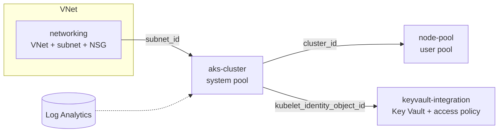

# terraform-aks-modules

[](https://github.com/saimedarametla/terraform-aks-modules/actions/workflows/terraform-validate.yml)


Reusable Terraform modules for production-grade Azure Kubernetes Service (AKS) deployments.

Each module is small and single-purpose, so you can use them together (see the [example](examples/production-cluster)) or pick only what you need.

## Modules

| Module | What it does |
|---|---|
| [`networking`](modules/networking) | VNet, AKS subnet, and a network security group attached to the subnet |
| [`aks-cluster`](modules/aks-cluster) | AKS cluster with Azure CNI, Azure AD RBAC, autoscaling system pool across zones, Key Vault CSI driver, Log Analytics integration, and a weekly maintenance window |
| [`node-pool`](modules/node-pool) | Autoscaling user node pool with taints, labels, zones and ephemeral OS disks |
| [`keyvault-integration`](modules/keyvault-integration) | Key Vault (soft delete, purge protection) with read access for the AKS kubelet identity |

## Architecture



## Features

- Azure CNI networking with network policy
- Azure AD integration with Azure RBAC for Kubernetes authorization
- System pool restricted to critical add-ons (`only_critical_addons_enabled`)
- Autoscaling and zone-spread node pools with surge upgrades
- Optional private API server (`private_cluster_enabled`)
- Key Vault Secrets Provider add-on with secret rotation
- Managed identity throughout, no service principal secrets
- Local Kubernetes admin accounts disabled (Azure AD only) and Azure Policy add-on on
- Key Vault locked down with network ACLs (default deny) and a service endpoint for the AKS subnet
- Optional API server IP allow-list and automatic upgrade channel
- Maintenance window (Sunday 01:00-04:00)
- CI runs `terraform fmt`, `terraform validate`, `tflint` and `checkov` on every module

## Usage

```hcl
module "networking" {
  source              = "github.com/saimedarametla/terraform-aks-modules//modules/networking?ref=v1.0.0"
  cluster_name        = "aks-prod-001"
  resource_group_name = "rg-aks-prod"
}

module "aks_cluster" {
  source              = "github.com/saimedarametla/terraform-aks-modules//modules/aks-cluster?ref=v1.0.0"
  cluster_name        = "aks-prod-001"
  resource_group_name = "rg-aks-prod"
  subnet_id           = module.networking.aks_subnet_id
  # kubernetes_version defaults to the current AKS default; pin it if you need to

  private_cluster_enabled    = true
  log_analytics_workspace_id = azurerm_log_analytics_workspace.this.id
}

module "app_pool" {
  source                = "github.com/saimedarametla/terraform-aks-modules//modules/node-pool?ref=v1.0.0"
  node_pool_name        = "apppool"
  kubernetes_cluster_id = module.aks_cluster.cluster_id
  subnet_id             = module.networking.aks_subnet_id
  node_taints           = ["workload=app:NoSchedule"]
  node_labels           = { workload = "app" }
}
```

A full multi-environment example (dev/uat/prod sizing) is in [`examples/production-cluster`](examples/production-cluster):

```bash
cd examples/production-cluster
terraform init
terraform plan -var-file=dev.tfvars
```

## Requirements

| Name | Version |
|---|---|
| Terraform | >= 1.3 |
| azurerm provider | ~> 3.100 |

## Inputs and outputs

Full tables live in each module's `variables.tf` and `outputs.tf`. Key ones:

**aks-cluster:** `cluster_name`, `resource_group_name`, `subnet_id` (required); `location`, `kubernetes_version`, `sku_tier` (default `Standard`), `private_cluster_enabled`, `api_server_authorized_ip_ranges`, `automatic_channel_upgrade`, `default_node_pool`, `log_analytics_workspace_id`, `tags` (optional).
Outputs: `cluster_id`, `cluster_name`, `kube_config` (sensitive), `kubelet_identity_object_id`, `cluster_identity_principal_id`, `node_resource_group`.

**networking:** `cluster_name`, `resource_group_name` (required); `vnet_address_space`, `aks_subnet_prefix`. Outputs: `vnet_id`, `aks_subnet_id`.

**node-pool:** `node_pool_name`, `kubernetes_cluster_id`, `subnet_id` (required); `vm_size`, `min_count`, `max_count`, `node_taints`, `node_labels`, `os_disk_size_gb`. Outputs: `node_pool_id`, `node_pool_name`.

**keyvault-integration:** `cluster_name`, `resource_group_name`, `tenant_id`, `kubelet_identity_id` (required); `allowed_subnet_ids`, `allowed_ip_ranges` (the vault denies all other network access). Outputs: `key_vault_id`, `key_vault_uri`.

## Security notes

CI runs Checkov on every push. These findings are skipped on purpose, with the reason recorded next to the resource:

| Check | Why it is skipped |
|---|---|
| Private cluster, API server IP ranges, upgrade channel | Opt-in through variables, so each team chooses its own access and upgrade model |
| 50+ pods per node | Azure CNI reserves one IP per pod, so this needs a bigger subnet than the default /24 |
| Host encryption | Needs the `EncryptionAtHost` feature registered on the subscription |
| Disk encryption set | Needs a customer-managed key |
| Ephemeral OS disk on the system pool | Depends on the VM SKU cache size |
| Key Vault private endpoint | Needs your own DNS design; the vault uses network ACLs plus a service endpoint instead |

`sku_tier` defaults to `Standard` (paid uptime SLA). Set `Free` for dev clusters.

## Contributing

See [CONTRIBUTING.md](CONTRIBUTING.md).

## License

MIT. See [LICENSE](LICENSE).
